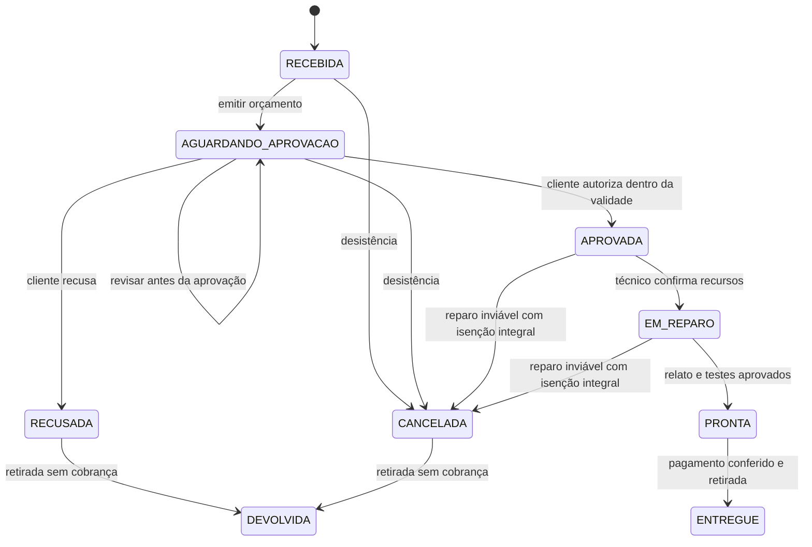

# Gestão de Assistência Técnica de Computadores

Aplicação de terminal em Java puro para uma assistência pequena: receber computadores, diagnosticar, orçar, obter autorização, reparar, conferir pagamento e entregar. As ordens são salvas em arquivo local e continuam disponíveis após reiniciar o programa.

O projeto utiliza orientação a objetos e padrões de projeto para organizar as regras de atendimento. Não usa Spring, banco de dados, bibliotecas externas nem um contêiner de injeção de dependências.

## Executar

Requisito: **JDK 17 ou superior**, com `java` e `javac` no PATH. Desenvolvimento e verificações realizados com JDK 21, compilando para Java 17.

Windows, no PowerShell, a partir desta pasta:

```powershell
.\executar.ps1
```

Linux/macOS, em terminal UTF-8:

```sh
sh executar.sh
```

Não é necessário Maven nem acesso à internet. O `Main.java` abre o menu; os dados não são pré-cadastrados. Os scripts compilam o código antes da execução.

Para usar outra pasta de dados, por exemplo para demonstrar sem misturar atendimentos:

```powershell
.\executar.ps1 -Dados data/demonstracao
```

No IntelliJ, configure JDK 17+, marque `src/main/java` como Sources Root e execute `br.com.assistencia.Main` com codificação UTF-8. O diretório de trabalho deve ser a raiz do projeto.

## Padrões de projeto

| Padrão | Categoria | Problema de negócio resolvido | Participantes principais |
| --- | --- | --- | --- |
| Builder | Criacional | Montar orçamento gradualmente com diagnóstico, validade, itens opcionais e política de preço; só produzir um orçamento completo e válido. | `Orcamento.Builder` e `Orcamento` |
| Factory Method | Criacional | Exportar a mesma ficha em TXT ou HTML imprimível sem o fluxo de exportação conhecer a implementação do documento. | `ExportadorOrdem`, `ExportadorTexto`, `ExportadorHtml`, `DocumentoOrdem`, `DocumentoTexto`, `DocumentoHtml` |
| Composite | Estrutural | Orçar itens avulsos e pacotes de manutenção pela mesma interface, somando separadamente peças e serviços, sem duplicar a cobrança. | `ComponenteOrcamento`, `ItemOrcamento`, `PacoteServicos` |
| Facade | Estrutural | Oferecer ao terminal casos de uso que coordenam regras da ordem, persistência, consulta e exportação. | `AssistenciaFacade` |
| Strategy | Comportamental | Alternar preço normal e campanha de 10% na mão de obra, preservando integralmente o preço das peças. | `PoliticaPreco`, `PrecoNormal`, `DescontoMaoDeObra`; contexto: construção do orçamento |
| State | Comportamental | Impedir reparo sem aprovação, alterações após autorização e entregas em etapas incompatíveis. | `OrdemServico` como Context; `EstadoOrdem` e corpos específicos das constantes como State/ConcreteStates |

Os participantes indicam seu papel nos Javadocs. O menu identifica os padrões usados com mensagens como `[Builder + Strategy]`, `[Composite]`, `[Facade + State]` e `[Facade -> Factory Method]`.

## Fluxos e regras de negócio



- Entrada exige cliente, telefone com DDD, marca/modelo, série ou etiqueta física única, condição física, acessórios e defeito relatado. Sem série, a loja deve fixar uma etiqueta própria.
- Uma série/etiqueta não pode ter duas ordens ainda em posse da assistência. Mesmo ordens recusadas/canceladas bloqueiam outro atendimento até a devolução física.
- Orçamento exige diagnóstico e itens positivos. Quantidades: 1 a 100. Até 30 itens/pacotes por orçamento e até 30 componentes por pacote. Dinheiro usa `BigDecimal`, duas casas decimais e limite de R$ 9.999.999,99 por total; não há `double` financeiro.
- Campanha é uma condição comercial disponível a todos os clientes e vale somente para os serviços. Exemplo: peça de R$ 200,00 + serviço de R$ 100,00 = R$ 300,00 no preço normal, ou R$ 290,00 na campanha.
- A validade é inclusiva: pode aprovar no dia do vencimento. Depois dele é necessário revisar e obter nova aprovação. A versão aprovada é imutável.
- O histórico registra revisões, autorização, recusa, técnico, testes, pagamento e retirada. Não há setter público para o estado.
- Reparo exige autorização e confirmação de recursos/peças disponíveis. A conclusão exige relato técnico e testes aprovados; uma reprovação mantém a ordem em reparo.
- Pagamento é registrado uma única vez, após a conclusão, pelo total exato aprovado. A referência do comprovante/controle de caixa deve ser única entre as ordens. Pix/cartão são recebidos fora do programa; dinheiro informa valor líquido após eventual troco.
- Entrega só ocorre após a quitação. O atendente confirma presencialmente a identidade e a autorização de quem retira.
- Diagnóstico não é cobrado neste modelo. Recusa ou cancelamento anterior à aprovação permitem devolução gratuita.
- Reparo inviável após aprovação pode ser encerrado com decisão técnica e **isenção integral autorizada pela loja**. A assistência assume eventuais custos; não se registra cobrança parcial. A devolução encerra a custódia.
- Operações repetidas ou incompatíveis são rejeitadas. Digitar `:voltar` descarta um formulário; entrada encerrada antes da confirmação também não salva operações parciais.

## Persistência e arquivos

- `data/ordens.bin`: arquivo principal versionado; contém também o histórico e os comprovantes internos.
- `data/ordens.bak`: cópia da versão anterior, criada antes de substituir o arquivo principal. Não equivale a backup externo ou histórico completo de versões.
- `data/assistencia.lock`: trava da aplicação. Duas instâncias não podem operar simultaneamente na mesma pasta. A presença do arquivo após sair é normal; a trava é liberada ao fechar.
- `data/exportacoes/`: fichas UTF-8 TXT/HTML, com nomes únicos. O HTML escapa os campos digitados e pode ser impresso pelo navegador.

Os caminhos acima mudam se for fornecida outra pasta de dados. Os arquivos contêm dados dos clientes e não são enviados ao GitHub (`data/` é ignorada). Se escolher uma pasta diferente fora de `data/`, mantenha-a fora do repositório.

A gravação usa arquivo temporário e substituição atômica. Se o sistema de arquivos não suportar a operação, o programa informa a falha e conserva o arquivo principal. Cada alteração trabalha com uma leitura independente; falhar ao salvar não altera a versão confirmada. Um arquivo inválido gera erro e nunca é automaticamente substituído por uma base vazia.

Para recuperar manualmente a última versão anterior: feche todas as instâncias, preserve uma cópia da pasta inteira e copie `ordens.bak` sobre `ordens.bin`. A versão posterior ao backup será perdida. Mantenha backups externos se usar dados reais; o arquivo não deve ser editado manualmente.

## Estrutura

```text
src/main/java/br/com/assistencia/
  Main.java                  composição das dependências e terminal
  dominio/                   entidades, valores e invariantes
  padroes/orcamento/         Composite
  padroes/preco/             Strategy
  padroes/estado/            State
  padroes/exportacao/        Factory Method
  servicos/                  Facade e contrato de repositório
  infra/                     implementação de persistência
src/test/java/               testes de negócio e integração
```

Builder fica junto de `Orcamento`, o produto que constrói. `Main` monta as dependências e as injeta por construtores, incluindo o repositório, o relógio e os exportadores da fachada. A política escolhida é fornecida ao construtor do Builder, antes de construir o orçamento.

## Testes

```powershell
.\testar.ps1
```

Ou `sh testar.sh` em Linux/macOS. Os testes não usam bibliotecas externas, não dependem de `-ea` e usam diretórios temporários separados dos atendimentos reais.

As 110 verificações cobrem construtores, valores e arredondamento; orçamento imutável e pacotes; autorização e validade; transições inválidas/repetidas; recursos e testes técnicos; pagamento incorreto/duplicado; recusa, cancelamento e inviabilidade; bloqueio de equipamento e de segunda instância; persistência após reinício; falha de gravação; arquivo corrompido; escape de HTML; exportação TXT/HTML; e um fluxo interativo real em um processo Java separado, incluindo entrada inválida e fim de entrada.

## Escopo e limites

Aplicação local para **um atendente de cada vez**, sem autenticação. Os nomes registrados são declarações do atendente; não substituem assinatura digital ou prova de autorização. Não há estoque, compra de peças, acesso remoto, envio de mensagens, gateway bancário, emissão fiscal, parcelamento, cobrança parcial ou estorno. O técnico confere recursos e o atendente confere recebimento/retirada fora do sistema.

O programa não armazena senhas de computadores nem acessa arquivos do cliente. Autorizações para acesso a dados, backup e formatação precisam ser obtidas pela loja fora do sistema. Orçamento e ficha são controles internos; não são nota fiscal.

Uma ordem entregue permanece encerrada e disponível para consulta. Retorno em garantia, contestação de serviços e substituição de equipamento exigem avaliação da loja; não há automação de garantia nesta versão. Não abra uma nova ordem cobrada para um retorno sem essa avaliação. A persistência é adequada ao escopo local didático; operação de produção com múltiplos atendentes exige banco transacional, controle de acesso e política de backup.

## Referência de estudo

GAMMA, Erich; HELM, Richard; JOHNSON, Ralph; VLISSIDES, John. *Design Patterns: Elements of Reusable Object-Oriented Software*. Addison-Wesley, 1994. Catálogo GoF: [padrões criacionais](https://www.oreilly.com/library/view/design-patterns-elements/0201633612/ch03.html), [estruturais](https://www.oreilly.com/library/view/design-patterns-elements/0201633612/ch04.html) e [comportamentais](https://www.oreilly.com/library/view/design-patterns-elements/0201633612/ch05.html). O código e os casos de uso são específicos deste projeto.
